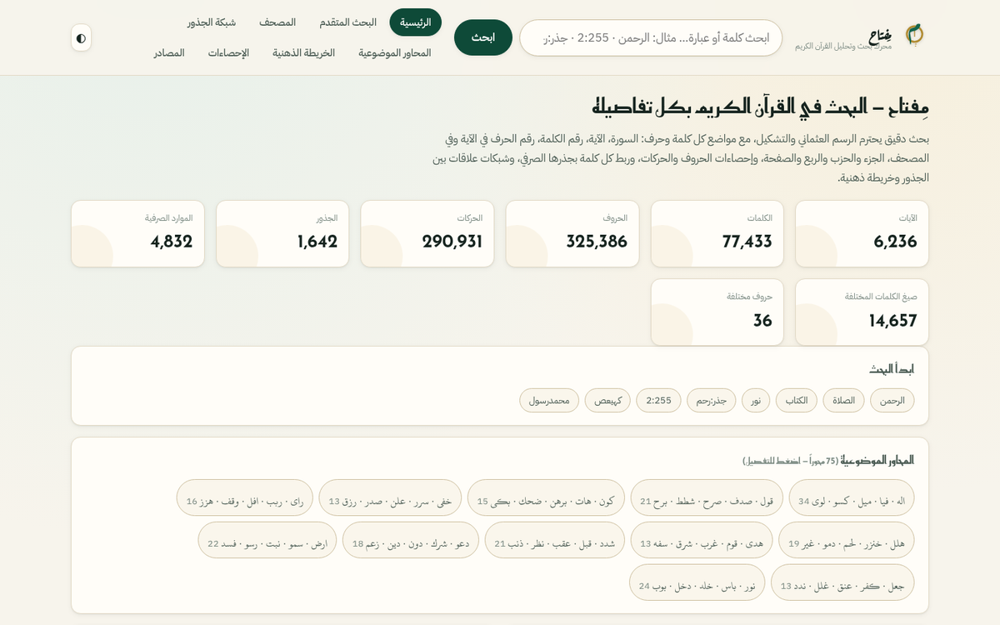
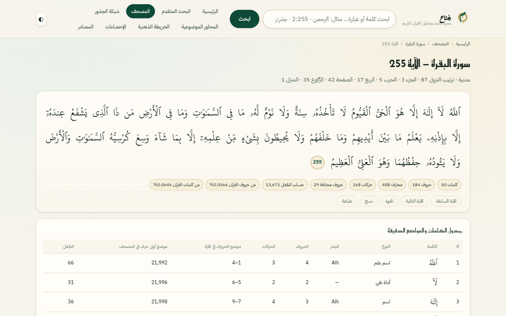
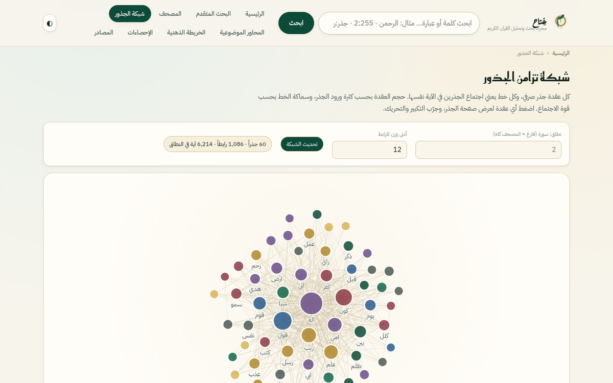
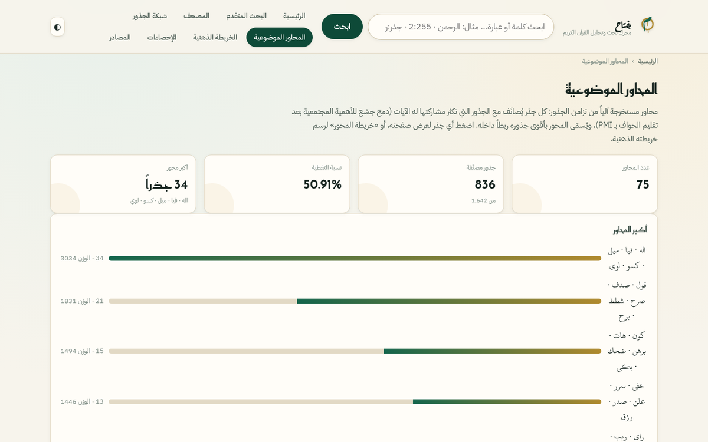
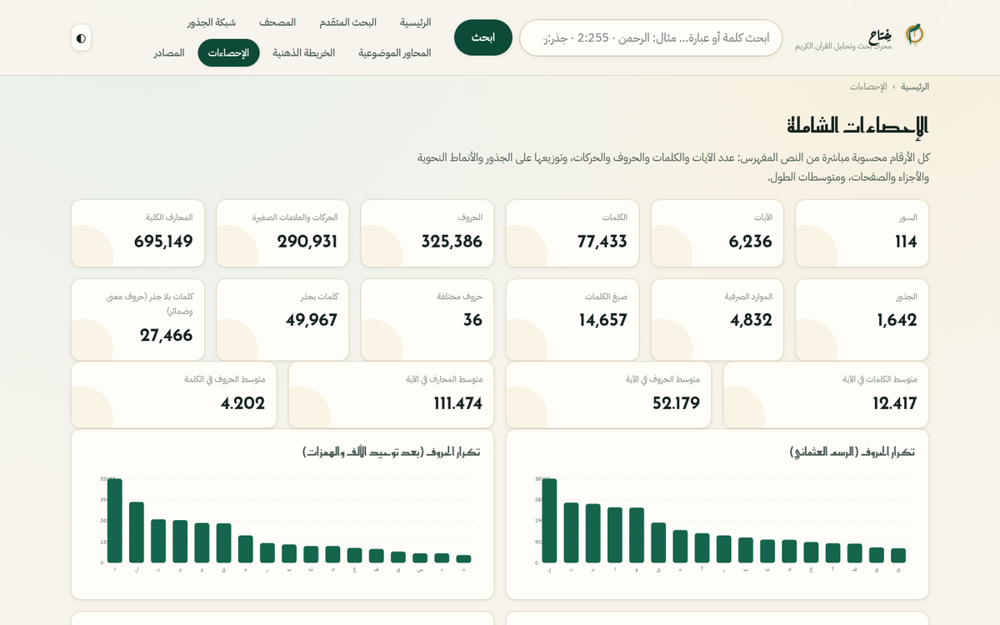
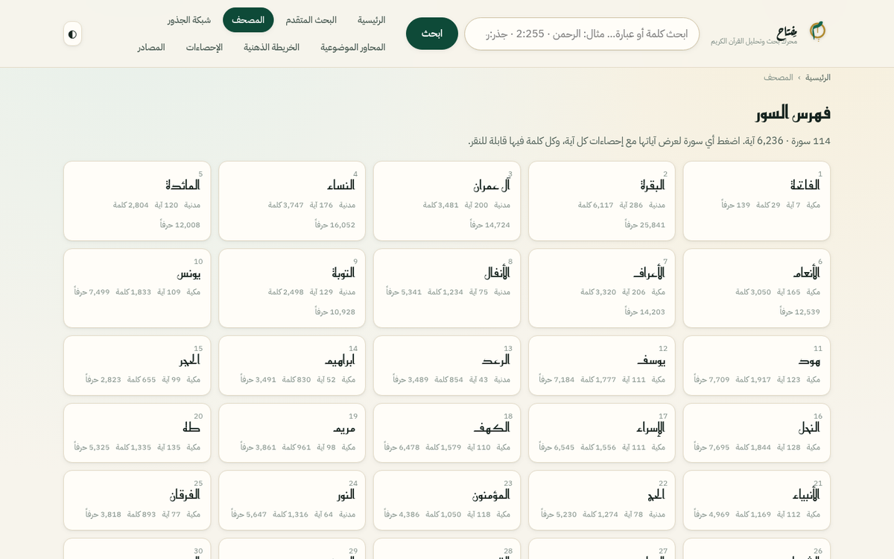

# Miftāḥ · مِفتاح — an offline, tashkeel-aware Qur'an search engine

[](https://www.gnu.org/licenses/gpl-3.0)
[](https://www.python.org/)
[](#design-constraints)
[](#tests)

**Miftāḥ** (*key*) is an Arabic-first, self-contained web application for searching and analysing the
Qur'an in the ʿUthmānī script. It answers the question ordinary Qur'an search engines skip: not only
*which verse* matches, but **where exactly** — and *why*.

Every result carries its precise position: sūra, āya, word number, letter number inside the word, letter
number inside the āya, letter number in the **entire muṣḥaf**, juzʾ, ḥizb, rubʿ, manzil, rukūʿ and page —
alongside letter and diacritic counts, the morphological segmentation, the root, and the abjad value.

- **Arabic-first UI** — the interface is fully Arabic and RTL, dark and light themes, fonts embedded locally.
- **Fully offline** — no CDN, no build step, no network at runtime. Fonts and D3 are vendored in the repo.
- **Engine in the standard library** — search, morphology and statistics use only Python's stdlib
  (`sqlite3`, `math`, `collections`, `argparse`, `json`). FastAPI + Uvicorn run the HTTP layer, nothing else.
- **61 tests**, `unittest` only.
- **GPL-3.0-or-later.**

---

## Contents

- [What makes it different](#what-makes-it-different)
- [Screenshots](#screenshots)
- [Quick start](#quick-start)
- [Repository layout](#repository-layout)
- [How the search works](#how-the-search-works)
- [Reference numbers](#reference-numbers)
- [Topic clusters: why not label propagation](#topic-clusters-why-not-label-propagation)
- [HTTP API](#http-api)
- [Tests](#tests)
- [Reproducibility](#reproducibility)
- [The offline promise](#the-offline-promise)
- [Attribution and third-party licences](#attribution-and-third-party-licences)
- [Licence](#licence)

---

## What makes it different

| Feature | Detail |
|---|---|
| **Tashkeel-aware matching** | Every word is indexed in three orthographic forms (ʿUthmānī without dagger alif · ʿUthmānī with it · full Imlāʾī), so `الصلاة`, `ٱلصَّلَوٰةَ` and `الصلوة` all reach the same location. The *respect tashkeel* option requires precisely the marks the reader typed, on the same letter. |
| **Every word is a tag** | Any word in any text is clickable and opens a tag page: all its occurrences, its forms across the muṣḥaf, its distribution per sūra, first and last occurrence, the gaps between occurrences, and its root. |
| **Exact position** | Every letter has a position in its word, in its āya and in the whole muṣḥaf; every word has the start of its letters, their count, its abjad value, its part of speech, its segments and its root. |
| **Roots and lemmas** | 1,642 roots and 4,832 lemmas from the Quranic Arabic Corpus, with derived forms and morphological segmentation (prefix · stem · suffix). |
| **Relationship graphs** | Root co-occurrence network (shared verses + PMI), a word network, a single-āya network of its words and roots, and a multi-ring radial mind map around any root. |
| **Topic clusters** | Roots are clustered into semantic axes automatically, with greedy modularity (CNM) — no external libraries. |
| **Statistics** | Letters (written vs normalised), diacritics, parts of speech, juzʾ distribution, Meccan/Medinan, longest and shortest āyāt and words, sajda positions, and āyāt that avoid a given letter entirely. |
| **Muṣḥaf view** | Index of the 114 sūras, every sūra with its āyāt, every word clickable, with recitation audio from five reciters. |
| **HTTP API** | 25 documented endpoints at `/api/docs` (27 HTTP routes in all — the home page and `/healthz` stay out of the schema). |

## Screenshots

*Home — search entry, corpus overview and quick statistics.*



*Āya page — the verse with every word clickable, its statistics, and the layered word → root graph.*



*Root co-occurrence network — the 60 strongest roots and their 1,086 weighted edges.*



*Topic clusters — 75 semantic axes covering 50.9% of the corpus's roots.*



*Statistics dashboard.*



*Muṣḥaf index.*



> The interface is Arabic by design; screenshots above are the real application (light theme).

## Quick start

```bash
git clone https://github.com/dailybarid/miftah.git
cd miftah
./run.sh                 # default port 8770
./run.sh 9000            # custom port
```

Then open <http://127.0.0.1:8770/>. Interactive API docs: <http://127.0.0.1:8770/api/docs>.

`run.sh` checks for `fastapi` and `uvicorn` (the only two required packages), builds `data/quran.db`
from the source texts on first run (~20 s, ~80 MB), builds the topic clusters if absent, and starts the
server.

```bash
python3 -m pip install --user fastapi uvicorn     # the only dependencies
python3 scripts/build_db.py                       # rebuild the database from data/sources/
python3 scripts/build_topics.py                   # rebuild topic clusters inside the database
```

## Repository layout

```
app/
  arabic.py        Arabic layer: normalisation, tashkeel, buckwalter decoding, letter and mark
                   classification, abjad values
  engine.py        Search engine: letter streams, exact positions, filters, roots and lemmas,
                   graphs, statistics
  main.py          FastAPI: 25 documented endpoints, 27 routes + static file serving
scripts/
  build_db.py      Build the SQLite database from Tanzil texts, the Leeds morphology corpus and
                   Tanzil metadata (atomic build: temp file + os.replace)
  build_topics.py  Cluster roots into topic axes (greedy modularity / CNM, stdlib only)
web/
  index.html       Application shell (RTL, entirely Arabic)
  css/app.css      Design system (night green, manuscript gold, ivory paper; dark theme)
  css/fonts.css    Locally bundled fonts + @font-face for the muṣḥaf face
  js/views.js      Every screen: home, results, āya, word, tag, root, sūra, muṣḥaf, stats,
                   graphs, mind map
  js/graph.js      Force network and mind map (D3)
  js/charts.js     Hand-built SVG charts (no chart library)
  js/api.js · util.js · app.js    Transport layer · helpers · hash router
data/sources/      The four source texts (committed to the repository)
data/quran.db      Built database (not committed — built by the command above)
```

Roughly 1,875 lines of Python in `app/`, 1,085 in `scripts/`, 1,850 lines of JavaScript, and 337 of
CSS in `app.css` (plus 385 generated `@font-face` lines in `fonts.css`).

## How the search works

1. **One normalisation for both text and query** — removal of tashkeel, waqf marks and tatweel, plus
   unification of alif (`آ أ إ ٱ` → `ا`), yāʾ (`ى` → `ي`) and tāʾ marbūṭa (`ة` → `ه`). Every step is
   individually switchable in the search options, with an additional option to ignore hamza.
2. **Three forms per word** in the index stream, with `letter position → word` and
   `letter index within the form` maps, so positions stay exact even when a query matches the
   Imlāʾī form rather than the ʿUthmānī one.
3. **Letter-level matching modes**: within a word, whole word, word start, word end, consecutive
   letters anywhere, **letters contiguous across word boundaries** (`محمدرسول` finds
   `مُّحَمَّدٌ رَّسُولُ`), and multi-word phrases with an optional proximity range.
4. **Respecting tashkeel** means every mark the reader typed must exist on the same letter; a query
   with no marks at all is an ordinary match.
5. **Roots** are resolved from the Leeds corpus after a letter alignment that is verified for every
   āya (`unmatched_words = 0`).

## Reference numbers

Ground truth for the build, reproducible from `data/quran.db`:

| Item | Count |
|---|---|
| Āyāt | 6,236 |
| Words | 77,433 |
| Letters | 325,386 |
| Diacritics and small Qur'anic marks | 290,931 |
| Distinct normalised word forms | 14,657 |
| Morphological segments | 128,223 |
| Words carrying a root | 49,967 |
| Roots | 1,642 |
| Lemmas | 4,832 |
| Sūras | 114 |
| Distinct letters | 36 |
| Sajda positions | 15 |

Note on letters: `325,386` counts letters proper and excludes the small Qur'anic marks
(U+06E5, U+06E6, U+06E2), which are classified separately as `small_letter` and counted inside the
290,931 marks figure. The two numbers are consistent by construction.

## Topic clusters: why not label propagation

Topic axes are derived entirely with the standard library (`scripts/build_topics.py`):

1. From the `root_ayah` table, build a weighted root graph: `weight(a, b)` = number of verses where
   both roots occur.
2. Prune the edges: co-occurrence ≥ `--min-weight`, a **PMI** threshold, and each root's strongest
   `--top-k` neighbours — so frequent roots cannot tie the whole graph together.
3. **Greedy modularity (CNM)** with a `--resolution` parameter and a strict `--max-size` cap on axis
   size, plus `split_oversized` as a safety net — producing many axes rather than one blob.
   (Label propagation was tried first and produced a single axis swallowing 836 roots, so it was
   replaced.)
4. Axes are labelled from their **internally strongest** roots, not the corpus's most frequent ones
   (otherwise every label begins with «الله · قول»).
5. The result is stored in the `topic` and `topic_root` tables, served by `/api/topics`, and shown in
   the *Topic clusters* tab.

```bash
python3 scripts/build_topics.py                                  # defaults: 75 axes, largest 34 roots, 50.9% coverage, 0.2 s
python3 scripts/build_topics.py --resolution 6 --max-size 25     # finer axes
```

## HTTP API

| Endpoint | Description |
|---|---|
| `GET /api/meta` · `/api/suras` · `/api/sura/{n}?words=1` | General metadata, sūras, and a sūra's āyāt (optionally with words) |
| `GET /api/ayah/{s}/{a}` | The āya: words, positions, statistics, neighbours |
| `GET /api/word/{id}` | Word detail: letters and their marks and positions, segments, root, lemma |
| `GET /api/search` | Search: `q, mode, tashkeel, ignore_tashkeel, unify_alef, unify_ya, unify_ta, ignore_hamza, sura, juz, page_min, page_max, revelation, sajda, words_min/max, letters_min/max, proximity, limit, offset` |
| `GET /api/suggest` · `/api/tag` | Autocomplete · word tag page |
| `GET /api/roots` · `/api/root/{id}` · `/api/lemma/{id}` · `/api/compare` | Roots, lemmas and comparison |
| `GET /api/pos` · `/api/pos/search` | Parts of speech |
| `GET /api/stats` · `/api/stats/letters` · `/api/stats/ayah-letters/{s}/{a}` · `/api/stats/analysis/{s}/{a}` · `/api/stats/without-letter` | Statistics and per-āya analysis |
| `GET /api/graph/roots` · `/api/graph/mindmap` · `/api/graph/ayah/{s}/{a}` · `/api/graph/word` | Networks and mind map |
| `GET /api/topics` · `/api/random` | Topic clusters · a random āya |

## Tests

61 tests with the standard-library `unittest` (no pytest, no extra installs):

```bash
python3 -m unittest discover -s tests -t .          # all tests
python3 -m unittest tests.test_arabic -v            # Arabic layer only (no database needed)
python3 tests/test_engine.py                        # engine and HTTP API
```

The 8 HTTP-contract tests need a running server and read it from `QURAN_BASE` (default
`http://127.0.0.1:8770`). Without one the whole class is skipped and unittest reports
`Ran 53 tests … OK (skipped=1)`. So if you started the server on another port, point the suite at it:

```bash
QURAN_BASE=http://127.0.0.1:9000 python3 -m unittest discover -s tests -t .   # Ran 61 tests, OK
```

| File | Coverage |
|---|---|
| `tests/test_arabic.py` | Normalisation and tashkeel, dagger alif, Buckwalter decoding and structures, abjad values (the basmala = 786), search-form generation |
| `tests/test_engine.py` | Reference numbers, continuity of letter positions inside and across āyāt, tashkeel semantics (58 vs 47), letters contiguous across word boundaries (48:29), statistics, roots and tags, graphs and mind map, and the HTTP contract (skipped automatically when the server is not running) |

## Reproducibility

Every source file's **SHA-256** is recorded in `data/build_report.json` and stored in the database's
`meta` table, so a build can be checked against the one this repository was validated with. The build
is atomic (temp file + `os.replace`) to avoid a stale WAL file.

Two accuracy notes that are properties of the sources, not bugs:

- Four āyāt are merge points where one corpus word spans two ʿUthmānī words — 2:181, 8:6, 13:37 and
  37:130 (e.g. `بَعْدَمَا`). They are tagged `MERGED_WITH_PREVIOUS` and listed in
  `corpus_word_merges` in the build report. A separate counter, `alignment.ayahs_need_alignment`,
  reports 6 āyāt needing alignment; the two numbers measure different things.
- The basmala embedded at the start of the first āya of 112 sūras is excluded from statistics
  (`basmalas_stripped`), which is why the phrase «بسم الله الرحمن الرحيم» matches exactly two
  locations: 1:1 and 27:30.

## The offline promise

Everything needed to search, analyse and read runs on your machine: the corpus texts are committed,
the database is built locally, the fonts and D3 are vendored, and the UI makes no external requests.

**One exception:** the optional recitation audio is streamed from `everyayah.com`. It is off by
default in the sense that nothing loads until you press play, and it is the only network dependency
in the application.

## Attribution and third-party licences

| Source | Used for | Licence |
|---|---|---|
| [Tanzil](https://tanzil.net) `quran-uthmani` + `quran-simple-clean` | ʿUthmānī rasm, Imlāʾī form, āya and word counts | CC BY-ND 3.0 |
| [Quranic Arabic Corpus v0.4](https://corpus.quran.com) (Leeds, Kais Dukes) | Roots, lemmas, parts of speech, segments | GPL |
| `quran-data.xml` (Tanzil) | Sūra names, Meccan/Medinan, revelation order, juzʾ/ḥizb/page/sajda | CC BY |
| KFGQPC Uthmanic Hafs · Amiri Quran · IBM Plex Sans Arabic · Reem Kufi · Aref Ruqaa · Noto Naskh Arabic | Fonts, bundled in `web/fonts/` | KFGQPC EULA (free to use, copy and distribute; no sale, no modification) · OFL 1.1 |
| [D3](https://d3js.org) 7.9.0 | Networks and mind map, bundled in `web/vendor/` | ISC |
| everyayah.com | Recitation audio, loaded on demand | — |

The Qur'anic text is redistributed **verbatim and unmodified**, with attribution, as its licences
require; `data/quran.db` is a locally built index and is not committed. The KFGQPC font's end-user
licence agreement is reproduced in full at `web/fonts/LICENSE-KFGQPC.txt`; the other fonts are
SIL Open Font Licence 1.1. Bundled fonts and the D3 build keep their own licences and are **not**
covered by this project's GPL grant — see [NOTICE.md](NOTICE.md).

## Licence

Copyright (C) 2026 Khaled Mimoune (dailybarid).

This program is free software: you can redistribute it and/or modify it under the terms of the
**GNU General Public License** as published by the Free Software Foundation, either version 3 of the
License, or (at your option) any later version. It is distributed in the hope that it will be useful,
but WITHOUT ANY WARRANTY; without even the implied warranty of MERCHANTABILITY or FITNESS FOR A
PARTICULAR PURPOSE. See [LICENSE](LICENSE) for the full text.

## Contributing

Issues and pull requests are welcome. Useful things to know before you start:

- The engine is **stdlib-only** by design — please do not add third-party dependencies to `app/`.
- Tests use `unittest`, not pytest.
- After changing any JS or CSS, bump the `?v=` query in `web/index.html`; the app is served with
  `Cache-Control: no-cache` for the document and versioned static assets.
- The reference numbers in this README are the acceptance tests for any change to the build.

> The idea this grew from lives in `IDEA.md` — one line, all lowercase: *"an davnced quran search engine"*.
